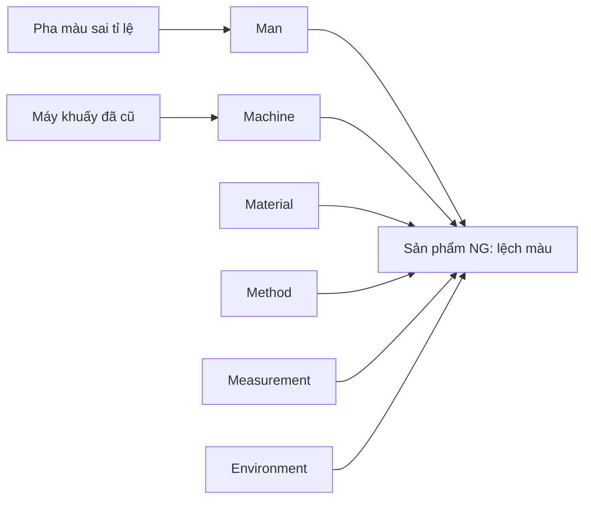

# Phân Tích Nguyên Nhân Gốc Sự Cố (RCA)

## Mục Tiêu
Đào tận gốc nguyên nhân sự cố (không dừng ở triệu chứng), ra hành động khắc phục + phòng ngừa để sự cố không tái diễn — yêu cầu bắt buộc của ISO 9001, IATF, FSSC.

## Khi Nào Dùng
- Sau khi xảy ra sự cố chất lượng/an toàn/giao hàng trễ
- Khiếu nại khách hàng nghiêm trọng
- Recall sản phẩm
- Tai nạn lao động
- Hệ thống IT down ảnh hưởng vận hành

## Bước 1: Mô Tả Sự Cố (5W2H)
Thu thập:
- **What**: Sự cố gì? (mô tả khách quan, không quy chụp)
- **When**: Thời điểm phát hiện + thời điểm bắt đầu
- **Where**: Khu vực/máy/line nào
- **Who**: Ai liên quan (không đổ lỗi)
- **Why** (ban đầu): Hiểu ban đầu là tại sao
- **How**: Phát hiện ra bằng cách nào
- **How much**: Thiệt hại (VND, giờ, %)

## Bước 2: Fishbone (Ishikawa) 6M
Vẽ xương cá với 6 nhánh chính:
- **Man** (Con người): training, kỹ năng, sức khỏe, kỷ luật
- **Machine** (Máy móc): bảo trì, hiệu chuẩn, cài đặt
- **Material** (Nguyên liệu): NCC, lô, bảo quản, hạn dùng
- **Method** (Phương pháp): SOP, work instruction, thông số
- **Measurement** (Đo lường): dụng cụ, chuẩn, người đo
- **Environment** (Môi trường): nhiệt độ, ẩm, bụi, ánh sáng

Mermaid:


## Bước 3: 5 Why Đào Sâu
Với mỗi nguyên nhân tiềm năng, hỏi "Tại sao?" 5 lần liên tục:

Ví dụ:
- Vấn đề: Sản phẩm lệch màu
- Why 1? → Pha mực sai tỉ lệ
- Why 2? → Công nhân đong bằng mắt thay vì cân
- Why 3? → Cân bị hỏng từ tuần trước
- Why 4? → Không có lịch bảo trì cân định kỳ
- Why 5? → SOP bảo trì thiết bị đo chưa được thiết lập
- **Root cause**: Thiếu hệ thống quản lý hiệu chuẩn dụng cụ đo

## Bước 4: Tích Hợp Web Bên Ngoài (MCP-first + API fallback)

**Ưu tiên dùng MCP/Connectors có sẵn:**
- Google Drive MCP: Lưu ảnh hiện trường + video CCTV
- Google Sheets MCP: Log incident database với Pareto chart
- Slack MCP: Tạo thread incident review với stakeholder
- Notion MCP: Database RCA có liên kết action plan
- Atlassian MCP (Jira): Tạo ticket follow-up action
- WebSearch: Tra benchmark ngành về sự cố tương tự

**Fallback bằng API (nếu cần làm sâu hơn):**
```python
# Tạo Jira ticket cho mỗi action sau RCA
import requests
JIRA_URL = "https://company.atlassian.net"
auth = ("email@co.vn", "API_TOKEN")
for action in action_list:
    requests.post(f"{JIRA_URL}/rest/api/3/issue", auth=auth,
        json={"fields": {"project": {"key": "OPS"},
                         "summary": action["title"],
                         "duedate": action["due"],
                         "assignee": {"id": action["owner"]},
                         "issuetype": {"name": "Task"}}})
```

## Bước 5: Output Format
- `RCA_<incident-id>.md` — báo cáo đầy đủ 5W2H + 5 Why + Action
- `RCA_Fishbone_<incident-id>.mmd` — Mermaid Fishbone
- `RCA_ActionPlan_<incident-id>.xlsx` — bảng action với owner/due/status
- `RCA_8D_<incident-id>.docx` — báo cáo 8D nếu khách yêu cầu (Ford/Tier-1)
- Lưu tại `/Users/nguyenkiem/Documents/Claude/SKILL/outputs/RCA/`

## Checklist Trước Khi Giao
- [ ] Mô tả sự cố khách quan, có số liệu
- [ ] Đã hỏi 5 Why thực sự đào sâu (không dừng ở Why 2)
- [ ] Có ít nhất 3 nhánh Fishbone được khám phá
- [ ] Action có Owner + Due date + đo lường được
- [ ] Phân biệt rõ Corrective (khắc phục) vs Preventive (phòng ngừa)
- [ ] Có lịch verify hiệu quả sau 30/60/90 ngày
