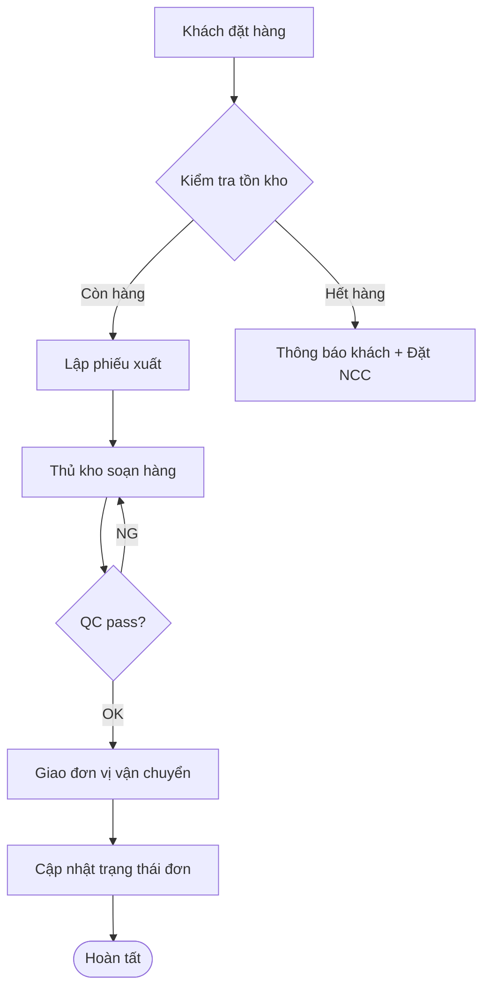

# Sinh Flowchart Quy Trình Vận Hành

## Mục Tiêu
Biến mô tả quy trình bằng văn bản thành sơ đồ trực quan giúp team dễ hiểu, phát hiện bước thừa/lặp/bottleneck, dùng để training và cải tiến quy trình.

## Khi Nào Dùng
- Cần giải thích quy trình phức tạp cho team mới
- Audit quy trình tìm chỗ tối ưu
- Tài liệu hóa quy trình vào SOP/Wiki
- Trình bày cho sếp/khách hàng/auditor
- Mapping As-Is vs To-Be khi tái cấu trúc

## Bước 1: Thu Thập Đầu Vào
Hỏi 4 câu:
1. Tên quy trình + mục tiêu cuối
2. Các bước/hành động (liệt kê thô từ start đến end)
3. Các điểm quyết định (Yes/No, OK/NG, Duyệt/Từ chối)
4. Các bộ phận tham gia (cho swimlane)

## Bước 2: Chọn Loại Diagram
- **Flowchart đơn giản** (top-down): quy trình tuyến tính < 10 bước
- **Swimlane** (phân làn theo phòng ban): quy trình liên phòng
- **BPMN**: quy trình phức tạp có event, message
- **Value Stream Map**: phân tích Lean, có thời gian + waste

## Bước 3: Sinh Mermaid Code
Dùng cú pháp Mermaid:



Quy ước hình khối:
- `[]` Hành động
- `{}` Quyết định
- `()` Bắt đầu/Kết thúc
- `[[]]` Sub-process
- `[/x/]` Input/Output (parallelogram)

## Bước 4: Tích Hợp Web Bên Ngoài (MCP-first + API fallback)

**Ưu tiên dùng MCP/Connectors có sẵn:**
- Notion MCP: Embed Mermaid code vào Notion page (Notion render native)
- Google Drive MCP: Upload file SVG vào Drive shared
- Atlassian MCP: Đẩy diagram vào Confluence page
- Figma MCP (nếu có): Tạo phiên bản design pro hơn
- WebFetch: Lấy template diagram từ Mermaid Live Editor

**Fallback bằng API (nếu cần làm sâu hơn):**
```python
# Render Mermaid thành PNG/SVG dùng mermaid.ink
import requests, base64
mermaid_code = "graph TD; A-->B; B-->C"
encoded = base64.urlsafe_b64encode(mermaid_code.encode()).decode()
url = f"https://mermaid.ink/img/{encoded}?type=png"
img = requests.get(url).content
open("flowchart.png", "wb").write(img)
```

## Bước 5: Output Format
- `flowchart_<process>.mmd` — Mermaid source
- `flowchart_<process>.svg` — SVG xuất ra
- `flowchart_<process>.html` — HTML preview với Mermaid.js
- Markdown snippet sẵn paste vào Notion/Confluence/GitLab Wiki
- Lưu tại `/Users/nguyenkiem/Documents/Claude/SKILL/outputs/flowcharts/`

## Checklist Trước Khi Giao
- [ ] Mỗi nhánh quyết định có cả Yes và No
- [ ] Có Start node và End node rõ ràng
- [ ] Không có bước cô lập (orphan)
- [ ] Swimlane (nếu có) đặt đúng phòng ban
- [ ] Đã preview trên Mermaid Live Editor
- [ ] Có chú thích màu sắc cho bottleneck (đỏ) / automation (xanh)
